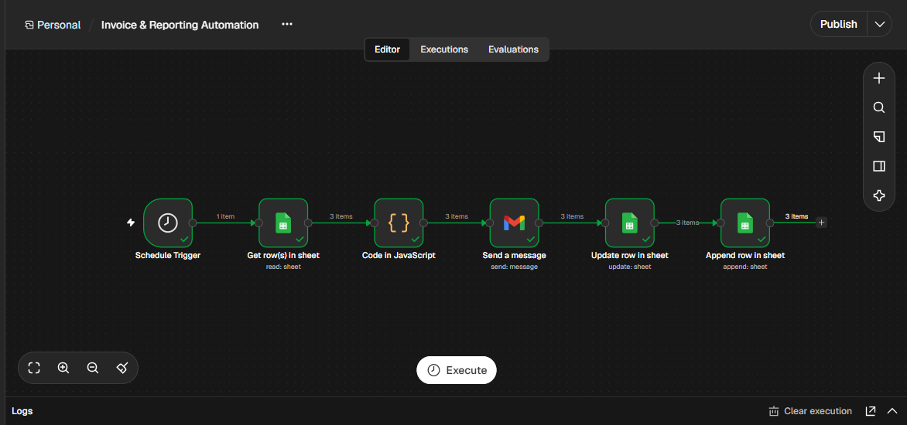
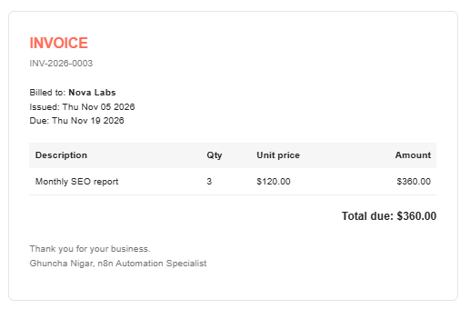
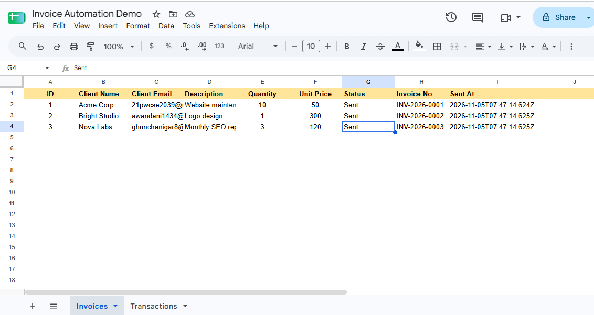

# Invoice & Reporting Automation (n8n)

An n8n workflow that turns a Google Sheet into a hands-off invoicing system: it finds pending invoices, calculates totals, generates a branded HTML invoice, emails it to the client through Gmail, marks the row as sent, and logs the transaction — so nothing is ever billed twice.

## Demo

**Video walkthrough:** [Watch the demo](https://www.loom.com/share/797e1a5ccac343f5a669e34c268700c4)

**Invoice email sent to the client**

**Sheet after the run: rows marked Sent, invoice numbers assigned**

## How it works

1. **Schedule Trigger** starts the workflow (every 15 minutes in the demo)
2. **Google Sheets: Get row(s)** reads only rows where `Status = Pending`
3. **Code node** calculates `Quantity × Unit Price`, creates an invoice number (`INV-2026-0001`), sets issue and due dates (14 days), and builds the HTML invoice
4. **Gmail: Send a message** emails each invoice to the client's address
5. **Google Sheets: Update row** sets `Status = Sent` and writes the invoice number and timestamp back to the row
6. **Google Sheets: Append row** logs the invoice in a separate `Transactions` sheet

Because only `Pending` rows are processed and each row is marked `Sent` after delivery, running the workflow again never sends duplicates.

## Google Sheet structure

**`Invoices` tab**

| ID | Client Name | Client Email | Description | Quantity | Unit Price | Status | Invoice No | Sent At |
|----|-------------|--------------|-------------|----------|------------|--------|------------|---------|
| 1 | Acme Corp | client@example.com | Website maintenance | 10 | 50 | Pending | | |

**`Transactions` tab**

| Invoice No | Client Name | Client Email | Amount | Sent At |
|------------|-------------|--------------|--------|---------|

Column names must match exactly, since n8n maps data by header name.

## Setup

1. Create a Google Sheet with the two tabs above and add a few `Pending` rows (use your own email address for testing).
2. In n8n, go to **Workflows → Import from file** and import `workflow.json`.
3. Create a **Google Sheets** credential and a **Gmail** credential (Sign in with Google).
4. In each Google Sheets node, select your spreadsheet and the correct tab.
5. Click **Execute workflow**. Invoices arrive by email and the sheet updates.
6. Publish the workflow to run it on the schedule.

## Customisation

| Want to change... | Do this |
|-------------------|---------|
| Currency | Change the `money` helper in the Code node (`'$'` to `'£'`, `'€'`, etc.) |
| Payment terms | Change `14` in the `due` date calculation |
| Invoice design | Edit the HTML template inside the Code node |
| Sender name / branding | Edit the heading and footer in the HTML |
| Run frequency | Change the interval in the Schedule Trigger |
| Add a PDF attachment | Add an HTML-to-PDF step before Gmail and attach the file |

## Troubleshooting

| Problem | Likely cause and fix |
|---------|----------------------|
| Get row(s) returns 0 items | No rows with `Status` exactly `Pending`, or a column name does not match |
| Only 1 invoice is generated | Set the Code node mode to **Run Once for All Items** |
| Update row fails to find the row | Check that **Column to match on** is `ID` and the value comes from the Code node |
| Same invoices sent repeatedly | The Update step did not run. Confirm `Status` changes to `Sent` in the sheet |

## Tech stack

n8n · Google Sheets API · Gmail API · JavaScript (Code node) · HTML email

## Author

**Ghuncha Nigar** — n8n Automation Specialist

- GitHub: [@GhunchaNigar](https://github.com/GhunchaNigar)
- LinkedIn: [Ghuncha Nigar](https://www.linkedin.com/in/ghuncha-nigar-320770255)
- Fiverr: [ghuncha_nigar](https://www.fiverr.com/ghuncha_nigar)
